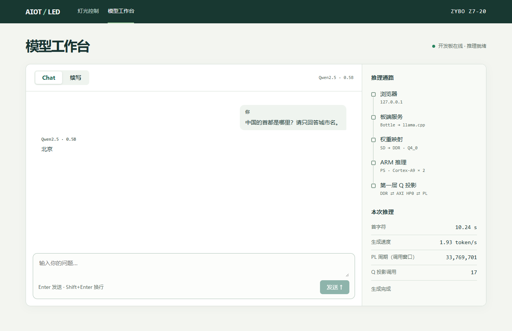

# Qwen 第一层查询投影

此页记录首层原型（提交 `0a0d337`）。现行实现见 [Qwen 全层矩阵后端](qwen-matrices.md)。

模型工作台提供 Chat 和英文续写两个模式。浏览器保存当前页面上的消息和草稿，Chat 的每一条问题独立送入模型。输入区、滚动消息区和侧栏的组织参考了 [Hugging Face Chat UI](https://github.com/huggingface/chat-ui/blob/main/src/lib/components/chat/ChatWindow.svelte)。本项目使用原生 HTML、CSS 和 JavaScript，开发板运行时无需外网。

## 板端分工

Qwen2.5-0.5B-Instruct 的 `blk.0.attn_q.weight` 是 896 × 896 的 Q4_0 矩阵。SDK 版 ggml 在激活量化后，将该矩阵的每个输入向量交给 PL，896 个输出直接写回原推理图。CPU 继续执行该层偏置、其他投影、注意力、后续层、分词和采样。英文续写维持原 ZyboGPT 字符推理核。

- 首次把 Q4 权重整理到保留 DDR。每块存储 32 个四位权重和一个浮点比例因子。
- ARM 写入一列 Q8 激活后，经 GP0 的 AXI-Lite 寄存器启动投影核。核经 HP0 读取权重和输入，完成整数点积、缩放及行累加，结果经 HP0 返回。
- 首次调用逐项对照 NEON 的 896 个参考输出。容差为 `0.0002 × (1 + abs(reference))`。超时或比对失败会终止该推理进程。
- 专用 1 MiB DDR 从 `0x1e000000` 起，Linux 通过启动设备树的 `reserved-memory/no-map` 排除该区域。控制寄存器在 `0x43c10000`，独立 50 MHz 周期计数器在 `0x41220000`。
- 网页按请求展示 Q 投影调用次数和各调用窗口的累计 PL 时钟。窗口从写启动寄存器前到读完成标志后，包含轮询开销。Qwen 的 token/s 来自 llama.cpp。ZyboGPT 的字符/s 和周期直接使用它自己的推理核计数器。

## 复现

1. 在项目的英文映射根目录下运行 `hardware/qwen/build-ip.ps1`，使用 Vivado HLS 2019.1 生成 AXI IP。
2. 在 Vivado Tcl Console 设置 `AIOT_GPT_RTL` 为项目的 `build/zybogpt/hw/gen`，设置 `AIOT_QWEN_IP` 为 `build/qwen_hls/sol/impl/ip`（均为绝对路径）。执行 `source hardware/panel.tcl`。综合、布局布线、BIT 和 HDF 均在本项目的 `build/qwen-panel`、`build/qwen-artifacts` 下。
3. 用 `device/build-qwen.ps1` 和 Xilinx SDK 2019.1 编译 ARM ELF。在 `build/qwen-artifacts` 运行 `bootgen -arch zynq -image ../../hardware/network.bif -process_bitstream bin -w`。
4. 按项目 SD 流程重建运行包。调用 `device/build-sd.sh` 时设置 `AIOT_QPROJ=1`、`AIOT_BIT_BIN=build/qwen-artifacts/panel_io_wrapper.bit.bin`，配套加载保留内存设备树和位流。签名写入备用槽并重启。
5. 在装有 Playwright 和 Edge 的 Windows 主机运行 `python tests/verify_llm.py`，同时运行灯控及 PL 向量回归。测试经本机网页发送真实提示词，检查问答附带非零投影调用数。

## 实板验收（2026-11-28）

HLS C 仿真对照独立整数参考，896 个输出匹配。Vivado 2019.1 合并位流使用 19573 个 LUT、31 个 BRAM Tile、60 个 DSP，50 MHz 布线后 WNS 为 3.781 ns，WHS 为 0.021 ns。BIT 和 HDF 见 `build/artifacts/qwen-panel.bit` 和 `build/artifacts/qwen-panel.hdf`，PS 程序为同目录的 `llama-server.elf`。

SD B 槽回读 FIT SHA-256 为 `faf9669d6298ebad20100f52a8fd7dd14500f9f322d4e0a248241ef09599b70b`。重启后版本为 `e0526dbb0749`，预热运行了 PL 投影，并通过首次输出对照。

Edge 提问“中国的首都是哪里？请只回答城市名。”，返回“北京”，首字符 10.24 秒，板端生成速度 1.93 token/s。该次请求调用 PL 投影 17 次，累计调用窗口 33769701 个 50 MHz 周期，约 0.675 秒。之前同题 ARM 基线首字为 9.8 秒，两次单样本结果未体现端到端提速。

续写模式返回 64 个字符。本机与板端均可访问 `/llm`。LD4、四路拨杆与 LED、双 RGB、同步效果和两组 ZyboGPT 硬件向量回归均通过。

