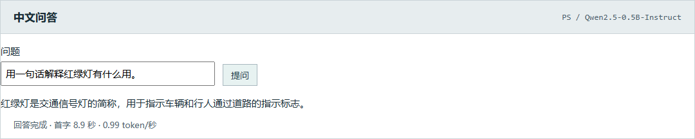

# 板端中文问答（ARM 基线）

当前工作台位于 `/llm`，带 PL 查询投影的版本见 [Qwen 第一层查询投影](qwen-pl.md)。

ARM 基线从本机控制台提交单轮中文问题，Bottle 把请求转给开发板回环地址上的 llama.cpp。Qwen2.5-0.5B-Instruct 在 PS 双核 Cortex-A9 上计算，使用 512 token 上下文、最多 80 token 回答和两条计算线程。英文续写继续使用 PL 中的 ZyboGPT。

## 从源码构建

Windows 安装 CMake、Ninja 和 Xilinx SDK 2019.1，在仓库根目录运行：

```powershell
./device/build-qwen.ps1 -Ninja 'ninja.exe'
```

脚本固定 llama.cpp b3948，替换 ggml 针对其他 ARM 板的浮点指令选项，生成 `build/artifacts/llama-server.elf`。Ninja 不在 PATH 时可传可执行文件的完整路径。[llama.cpp 源码](https://github.com/ggml-org/llama.cpp/tree/55e47786e373c90fc7803e718e3e1dd6d53c3db6)

## SD 卡与启动

将官方 Q4_0 权重保存为 SD 卡第一分区的 `qwen/qwen.gguf`。本次通过板端有线网口写入临时文件，核对 SHA-256 后改名。文件大小 428730208 字节，SHA-256 为 `7671c0c304e6ce5a7fc577bcb12aba01e2c155cc2efd29b2213c95b18edaf6ed`。[官方权重](https://huggingface.co/Qwen/Qwen2.5-0.5B-Instruct-GGUF/blob/main/qwen2.5-0.5b-instruct-q4_0.gguf)

按项目 SD 流程打包含 ZyboGPT 的镜像。S98aiot 在灯控启动后加载卡上权重，日志位于板端 `/tmp/aiot-led/qwen.log`。访问本机控制台的「中文问答」提问。运行 `python tests/verify_chat.py` 可从相同网页接口检查中文回答、首字延迟和板端生成速度。

## ZYBO Z7-20 实测

| 网页输入 | 板端原始回答 | 首字 | 生成速度 |
| --- | --- | ---: | ---: |
| 中国的首都是哪里？请只回答城市名。 | 北京 | 37.4 秒 | 1.24 token/秒 |
| 一盏红灯加两盏绿灯，一共有几盏灯？ | 一盏红灯加两盏绿灯，一共有三盏灯。 | 22.6 秒 | 0.66 token/秒 |

第一题加载完成后首次提问，第二题复用了相同的系统提示前缀。首字计时包含提示词计算。第一题仅生成两个 token，长回答的速度参考第二题。

## Cortex-A9 加速结果

优化版使用 ARMv7 NEON 的 8 位乘法和 16 位累加计算 Q4_0 点积，并查表转换半精度缩放值。每个 16 位累加通道最多叠加 4 个乘积，绝对值上界为 4096。模型、量化格式、线程数、系统指令和贪心采样设置与基线一致。

启动时提前计算所有问题共用的系统指令，并将前缀保留在推理槽的 KV 缓存。网页在预热完成后开放提问。下表的首字从提交问题开始计时；SD 启动及模型加载时间单列。两道问题均未预先提交。

| 同题同序测试 | 原首字 | 优化后首字 | 原生成速度 | 优化后生成速度 |
| --- | ---: | ---: | ---: | ---: |
| 中国的首都是哪里？请只回答城市名。 | 37.4 秒 | 9.8 秒 | 1.24 token/秒 | 1.96 token/秒 |
| 一盏红灯加两盏绿灯，一共有几盏灯？ | 22.6 秒 | 12.9 秒 | 0.66 token/秒 | 1.03 token/秒 |

两道题的回答逐字一致。第一题现场计算的提示 token 数从 37 降至 16；第二题两版均处理 21 个提示 token，提示计算速度从 0.93 升至 1.64 token/秒。本次 SD 重启后，首次观察到问答就绪时 Linux uptime 为 85 秒。灯控在模型预热期间已经上线。

Edge 实际输入“用一句话解释红绿灯有什么用。”，优化后首字 8.9 秒，生成速度 0.99 token/秒。


